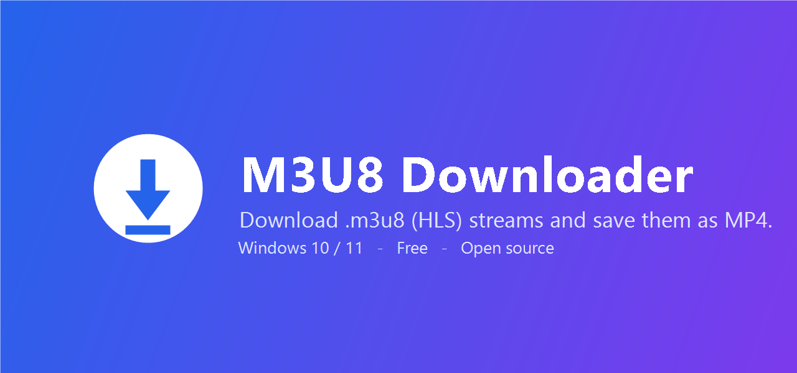
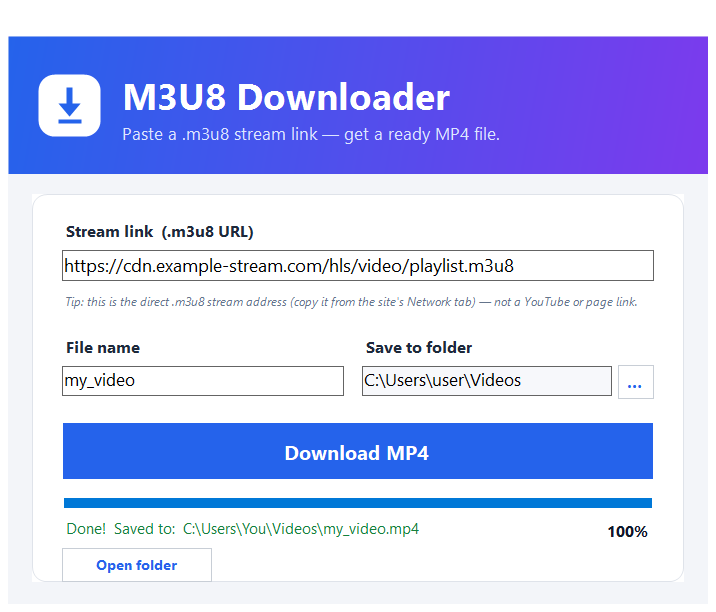
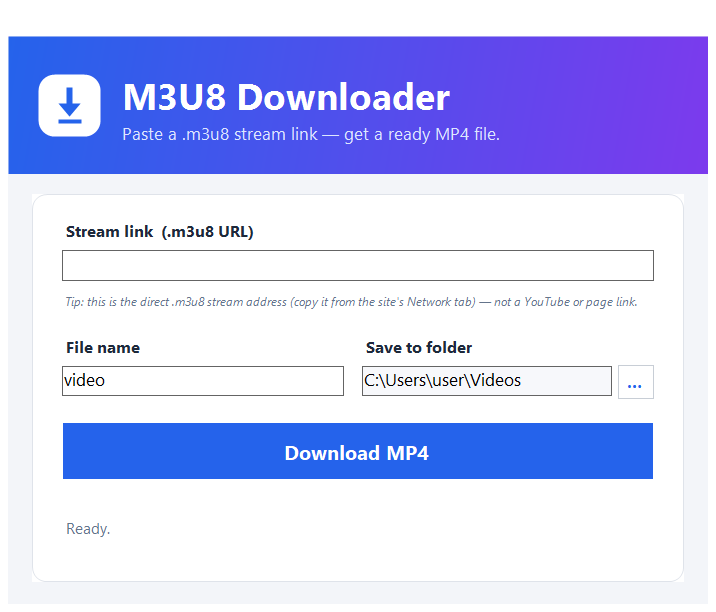

  

<h1 align="center">M3U8 Downloader</h1>

  <b>Paste a <code>.m3u8</code> stream link — get a ready MP4 file.</b> 
  A small, free, offline desktop app for Windows 10 / 11 (64-bit).

  
  
  
  

---

## What it does

**M3U8 Downloader** turns an `.m3u8` (HLS) stream link into a single `.mp4` file on your computer.

A huge number of sites — online cinemas, courses, webinars, sports streams, embedded video players — deliver video as **HLS**: an `.m3u8` playlist split into hundreds of small pieces. This app takes the `.m3u8` link you give it, downloads every piece, and joins them into one clean MP4 you can keep and watch offline.

> ℹ️ It works with **direct `.m3u8` stream links** — not YouTube or ordinary web-page URLs.

  

## Features

- 🎬 **One-click `.m3u8` → MP4** — paste a link, press one button
- 🧠 **Picks the best quality automatically** (video + audio)
- 📂 **Saves where you want** — defaults to your Videos folder and opens it when done
- ⚡ **Nothing to configure** — the downloader engine and FFmpeg are built in
- 🔒 **100% offline & private** — no account, no sign-up, nothing is uploaded anywhere
- 🪄 **Self-setup** — on first run it adds a Desktop and Start-Menu shortcut, so you never lose it
- 🆓 **Free and open source** (MIT)

## How to use

1. Download the latest release, unzip, and run the installer.
2. Launch the app, paste your `.m3u8` stream link.
3. *(optional)* set a file name and choose a folder.
4. Click **Download MP4** — when it finishes, the folder opens with your video.

> **Where do I get the `.m3u8` link?** Open the video in your browser, press `F12` → **Network** tab → type `m3u8` in the filter → copy the playlist address while the video is playing, and paste it here.

  

## Download

➡️ **[Download the latest release](../../releases/latest)** — unzip and run the installer. Windows 10 / 11, 64-bit.

## Built with

This app is a friendly desktop front-end around two excellent open-source tools, bundled unmodified and run as separate processes:

| Tool | Role | License |
|------|------|---------|
| [N_m3u8DL-RE](https://github.com/nilaoda/N_m3u8DL-RE) | downloads & merges HLS / DASH streams | MIT |
| [FFmpeg](https://ffmpeg.org) | muxes the result into MP4 | LGPL v2.1+ |

The app itself (its interface and wrapper code) is released under the **MIT License** — see [LICENSE](LICENSE). Building from source is described in [BUILD.md](BUILD.md).

---

<b>Keywords:</b> m3u8 downloader · m3u8 to mp4 · download m3u8 · hls downloader · m3u8 downloader for windows · convert m3u8 to mp4 · stream downloader · free · no ads · no account.
